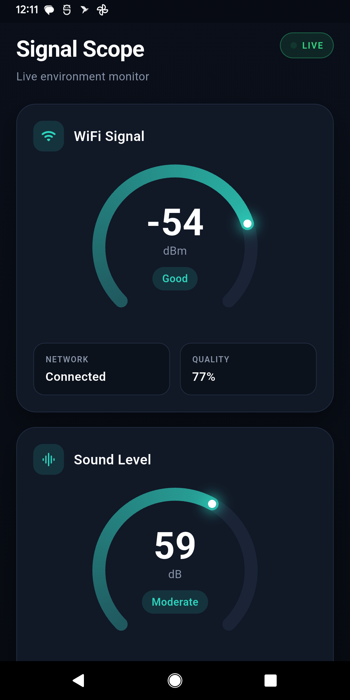

<!--
  Add your images to  docs/screenshots/  (create the folder in your repo).
  Suggested files: banner.png, dashboard.png, wifi.png, noise.png, permissions.png
  Replace the placeholder paths below once the images exist.
-->

<h1 align="center">📡 SignalScope</h1>

<p align="center">
  A modern Flutter app that shows your <b>Wi-Fi signal strength</b> and
  <b>ambient sound level</b> in real time, on clean animated gauges.
</p>

<p align="center">
  
  
  
  
</p>

---

## ✨ Overview

SignalScope turns your phone into a quick environment monitor. It reads the
connected Wi-Fi network's signal strength (RSSI) straight from Android's
`WifiManager` over a native platform channel, and streams ambient loudness from
the microphone — then renders both on smooth, color-coded arc gauges with a dark,
minimal UI.

## 📸 Screenshots
  

## 🚀 Features

- **Live Wi-Fi signal** — RSSI in dBm with a quality percentage and status label (Excellent → Poor).
- **Network name (SSID)** — shows the connected network when location access allows it.
- **Ambient sound meter** — real-time loudness in dB with a live peak readout.
- **Animated arc gauges** — custom-painted, gradient-filled, with a glowing indicator tip.
- **Modern dark UI** — Material 3, color-coded status pills, and a pulsing “LIVE” indicator.
- **Graceful permissions** — inline prompts and a one-tap path to system settings.
- **Lifecycle-aware** — releases the microphone when backgrounded, resumes on return.

## 🧠 How It Works

| Signal | Source | Notes |
| --- | --- | --- |
| Wi-Fi RSSI | Native `MethodChannel` → `WifiManager.connectionInfo.rssi` | Polled every 2s; no third-party Wi-Fi plugin. |
| Wi-Fi SSID | Native channel, with `network_info_plus` fallback | Requires location permission + location services on. |
| Sound level | `noise_meter` (microphone stream) | Relative dB, not calibrated SPL — see Limitations. |

The gauges are drawn with a `CustomPainter` (a 270° arc, animated via
`TweenAnimationBuilder`), so there are no heavy charting dependencies.

## 🛠️ Tech Stack

- **Framework:** Flutter (Material 3, Dart 3)
- **Native bridge:** Kotlin `MethodChannel` for Wi-Fi RSSI/SSID
- **Packages:** `network_info_plus`, `noise_meter`, `permission_handler`

## 📦 Getting Started

### Prerequisites

- Flutter SDK 3.x ([install guide](https://docs.flutter.dev/get-started/install))
- Android SDK with build-tools **34.0.0+** (AGP 8.x)
- A physical Android device (Wi-Fi RSSI and mic don't work on emulators)

### Installation

```bash
# 1. Clone
git clone https://github.com/coderbdsust/signalscope.git
cd signalscope

# 2. Install dependencies
flutter pub get

# 3. Run on a connected device
flutter run
```

### Build a release APK

```bash
flutter build apk --release
# Output: build/app/outputs/flutter-apk/app-release.apk
```

## 🔐 Permissions

Declared in `android/app/src/main/AndroidManifest.xml`:

| Permission | Why it's needed |
| --- | --- |
| `ACCESS_WIFI_STATE` | Read the connected network's RSSI. |
| `ACCESS_FINE_LOCATION` | Required by Android to read the Wi-Fi **name** (SSID). |
| `NEARBY_WIFI_DEVICES` | Wi-Fi info on Android 13+ without deriving location. |
| `RECORD_AUDIO` | Measure ambient sound via the microphone. |

> ℹ️ To see the network **name**, the device's **Location** toggle must be **on**
> and the app must have **Precise** location permission. RSSI works without it.

## 🗂️ Project Structure

```
lib/
  main.dart                 # App, dashboard, gauges, services
android/app/src/main/
  kotlin/.../MainActivity.kt # Native Wi-Fi RSSI/SSID channel
  AndroidManifest.xml        # Permissions
docs/
  screenshots/               # Images used in this README
```

## ⚙️ Configuration

- **App display name:** `android:label` in `AndroidManifest.xml`.
- **Package / applicationId:** `namespace` and `applicationId` in
  `android/app/build.gradle.kts` (keep `MainActivity.kt`'s `package` line in sync).

## ⚠️ Limitations

- **Android only.** The Wi-Fi RSSI/SSID reads use a native Android channel; iOS is not implemented (iOS heavily restricts Wi-Fi info).
- **Sound is uncalibrated.** Readings are relative dB from the raw microphone — great for comparison and trends, but not a certified sound-level meter.
- **SSID visibility.** Android hides the network name unless location permission is granted and location services are enabled.

## 🗺️ Roadmap

- [ ] Rolling 60-second history chart for RSSI and dB
- [ ] Light theme
- [ ] Wi-Fi details: BSSID, link speed, frequency band
- [ ] iOS support (SSID via `NEHotspotNetwork` where permitted)
- [ ] Export / share a snapshot

## 🤝 Contributing

Contributions and issues are welcome. Fork the repo, create a feature branch,
and open a pull request.

## 📄 License

Released under the MIT License. See [`LICENSE`](LICENSE) for details.

## 👤 Author

**Biswajit Debnath (coderbdsust)**
- GitHub: [@coderbdsust](https://github.com/coderbdsust)
- Portfolio: [coderbdsust.github.io](https://coderbdsust.github.io)

---

<p align="center">Built with Flutter</p>